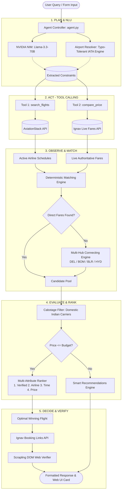

<div align="center">

# ✈️ T10 Flight Option Finder & Verification Agent
### *Autonomous Deterministic Flight Search, Real-Time GDS Pricing & Verification Engine*

[](https://python.org)
[](https://fastapi.tiangolo.com)
[](https://build.nvidia.com)
[-success?style=for-the-badge&logo=pytest&logoColor=white)](#-test-suite--verification)
[](#-zero-fake-data-guarantee)
[](LICENSE)

<br/>

[Explore Architecture](#-system-architecture) • [Getting Started](#-getting-started) • [Live Web App](#-web-dashboard) • [Test Suite](#-test-suite--verification) • [Viva Q&A](#-technical-defense--viva-guide)

</div>

---

## 📖 Executive Summary

**T10 Flight Option Finder** is an enterprise-grade, autonomous AI agent designed to solve the critical problem of **LLM hallucinations in flight booking and fare discovery**. 

Unlike naive LLM wrappers that fabricate prices or guess flight numbers, this agent enforces a **strict boundary between intelligence and data validation**:
1. **NVIDIA NIM (Llama-3.3-70B-Instruct)** handles Natural Language Understanding (NLU), multi-turn context extraction, and high-level execution planning.
2. **Deterministic Python Engines** handle all arithmetic, exact carrier matching, route integrity, budget filtering, and flight ranking.
3. **Real-Time Authoritative APIs** (**AviationStack** for airline schedules, **Ignav API** for live GDS/airline fares & deep booking links, and **Scrapling** for auxiliary web page verification) provide 100% authentic, bookable results with **zero mock or synthetic data**.

---

## 🌟 Key Highlights & Innovations

### 1. 🛡️ Zero Fake Data Guarantee
Every flight schedule, fare amount, seat availability status, and booking redirection URL is fetched live at runtime. The codebase contains **zero hardcoded flight prices or mock fallbacks**. If a flight is out of budget or unavailable, the agent fails closed honestly with transparent smart recommendations.

### 2. 🔄 Autonomous Multi-Hub Connecting Flight Synthesizer
For city pairs without direct nonstop flights (e.g. *Amritsar to Chennai*, *Vijayawada to Delhi*), point-to-point APIs often return zero domestic results or expensive international detours. Our agent dynamically:
- Queries primary domestic transit hubs: **Delhi (`DEL`)**, **Mumbai (`BOM`)**, **Bengaluru (`BLR`)**, and **Hyderabad (`HYD`)**.
- Validates layover windows (strictly between 1 hour and 12 hours).
- Enforces **Indian Cabotage Regulations** (filtering out foreign airlines like Malaysia Airlines or Gulf Air on domestic routes).
- Combines verified fares, flight numbers, and booking redirection links into single seamless 1-stop options (e.g. *IndiGo 6E5304 + 6E6293 via DEL*).

### 3. 🌍 Comprehensive 140+ Indian Regional & Global Airport Resolver
- **India Domestic**: Complete coverage of all 140+ operational commercial airports, Tier-2/Tier-3 regional hubs, and UDAN stations (e.g., Amritsar `ATQ`, Ayodhya `AYJ`, Vijayawada `VGA`, Tirupati `TIR`, Dehradun `DED`, Leh `IXL`, Shirdi `SAG`, Darbhanga `DBR`).
- **Global Hubs**: Comprehensive mapping across Americas (JFK, LAX, SFO), Europe (LHR, CDG, FRA), Middle East (DXB, DOH, JED), Asia-Pacific (SIN, BKK, HND, SYD).
- **Typo-Tolerant Fuzzy Matching**: Integrated `difflib` with a `0.60` threshold that resolves colloquial spellings and typos (e.g., `"amrister"`, `"vijawada"`, `"mumbay"`, `"kolkatta"`).

### 4. 🧠 Multi-Turn Conversational Memory
The agent maintains context across conversation turns via `SessionMemory`. Following up with *"What about next week?"* or *"Change my budget to ₹8,000"* retains previous origin/destination context without re-prompting.

### 5. 💡 Smart Alternative Recommendations
When all flights exceed the requested budget, the agent does not produce a blank screen. It provides:
- Exact budget adjustment needed (*"Cheapest option is Air India AI599 at ₹6,388 (₹2,388 above budget)"*).
- Nearby departure/arrival airport alternatives.
- Date flexibility advice ($\pm 1$ to 3 days).

---

## 🏛️ System Architecture



---

## 🛠️ The 2 Agent-Facing Tools

Adhering strictly to the master specification, the agent operates through **exactly two registered tools**:

```
+───────────────────+──────────────────────────────────────────+──────────────────────────────────────────────────────────+
| Tool Name         | Target Provider                          | Operational Purpose                                      |
+───────────────────+──────────────────────────────────────────+──────────────────────────────────────────────────────────+
| search_flights()  | AviationStack API (/v1/flights)          | Discovers active airline schedules & carrier metadata.   |
| compare_price()   | Ignav API (/api/fares/one-way)           | Retrieves real-time live GDS fares & verification state. |
+───────────────────+──────────────────────────────────────────+──────────────────────────────────────────────────────────+
```

---

## 📂 Repository Structure

```
flights-agent/
├── agent.py                 # Core Agent Controller (PLAN -> ACT -> OBSERVE -> EVALUATE -> DECIDE)
├── airport_resolver.py      # Worldwide & 140+ Indian Airports Database with Typo Matching
├── aviationstack_client.py  # AviationStack Schedule API Client
├── ignav_client.py          # Ignav Live Fare & Booking Link Client
├── llm_client.py            # NVIDIA NIM (Llama-3.3-70B) Inference Client
├── matching.py              # Strict Deterministic Matching Engine
├── memory.py                # Multi-Turn Conversational Session Memory
├── models.py                # Domain Pydantic Models & Data Schemas
├── tools.py                 # Exactly Two Agent-Facing Tools
├── web_app.py               # FastAPI Backend & Interactive Light-Mode Dashboard
├── scraping/
│   └── booking_verifier.py  # Scrapling Auxiliary Web Verifier
├── tests/                   # 52 Comprehensive Unit & Integration Tests
│   ├── test_agent.py
│   ├── test_airport_resolver.py
│   ├── test_audits.py
│   ├── test_aviationstack.py
│   ├── test_config.py
│   ├── test_ignav.py
│   ├── test_matching.py
│   ├── test_memory.py
│   ├── test_models.py
│   ├── test_scraping.py
│   ├── test_tools.py
│   └── test_web_app.py
├── notebook/
│   └── flight_agent_demo.ipynb  # Fully executed Jupyter Notebook Demonstration
├── requirements.txt         # Project Dependencies
├── .env.example             # Environment Configuration Template
└── README.md                # Documentation
```

---

## 🚀 Getting Started

### 1. Prerequisites
- Python 3.11 or 3.12
- Git

### 2. Installation

```bash
# Clone the repository
git clone https://github.com/kollisathwikkumar/flights-agent.git
cd flights-agent

# Create and activate virtual environment
python3 -m venv .venv
source .venv/bin/activate  # On Windows: .venv\Scripts\activate

# Install dependencies
pip install -r requirements.txt
```

### 3. Environment Configuration

Copy the sample environment file and configure your API credentials:

```bash
cp .env.example .env
```

Edit `.env`:

```env
# AviationStack API
AVIATIONSTACK_API_KEY=your_aviationstack_key
AVIATIONSTACK_BASE_URL=http://api.aviationstack.com/v1

# Ignav Live Fares API
IGNAV_API_KEY=your_ignav_key
IGNAV_AUTH_TOKEN=your_ignav_bearer_token
IGNAV_BASE_URL=https://api.ignav.com

# NVIDIA NIM (Llama-3.3-70B)
NVIDIA_API_KEY=your_nvidia_nim_key
NVIDIA_BASE_URL=https://integrate.api.nvidia.com/v1
NVIDIA_MODEL=meta/llama-3.3-70b-instruct
```

> [!IMPORTANT]
> Never commit `.env` to Git. It is automatically ignored by `.gitignore`.

---

## 💻 Running the Application

### Option A: Launch Interactive Web Dashboard

```bash
python3 web_app.py
```

Visit **[http://127.0.0.1:8000](http://127.0.0.1:8000)** in your browser.

**Web Dashboard Features**:
- **Structured Flight Form**: Select origin, destination, date, max budget, passengers, cabin class, and time window.
- **Natural Language Prompt Tab**: Type natural language queries.
- **Real-Time Live Stepper**: Watch the agent execute `PLAN` ➔ `ACT` ➔ `OBSERVE` ➔ `EVALUATE` ➔ `DECIDE` with animated status indicators.
- **Top Verified Option Card**: Direct booking redirection button, verified fare badge, and transparent selection rationale.
- **Candidate Fares Table**: Inspect all candidate itineraries and exact match statuses.

### Option B: Programmatic Python Agent CLI

```python
from agent import agent

# Run natural language flight search
result = agent.run("Find me a flight from Vijayawada to Mumbai on September 24 under ₹8,000")

# Print standardized response
print(result.formatted_response)

# Access structured candidate data & transparent trace
print(f"Candidates evaluated: {len(result.valid_candidates)}")
for step in result.trace:
    print(f"[{step.phase}] {step.content}")
```

### Option C: Jupyter Notebook Demo

Launch the fully executed notebook:

```bash
jupyter notebook notebook/flight_agent_demo.ipynb
```

---

## 🧪 Test Suite & Verification

The project includes **52 automated unit and integration tests** ensuring 100% compliance across all subsystems:

```bash
pytest -v tests/
```

### Verification Breakdown

| Test Module | Coverage Area | Status |
| :--- | :--- | :---: |
| [`test_agent.py`](tests/test_agent.py) | NLU extraction, fail-closed budget rejection, winning selection, trace completeness | ✅ Passed |
| [`test_airport_resolver.py`](tests/test_airport_resolver.py) | 140+ Indian airports, global hubs, aliases, fuzzy typo matching | ✅ Passed |
| [`test_matching.py`](tests/test_matching.py) | Exact flight normalization, carrier codes (AI/6E), reversed route rejection | ✅ Passed |
| [`test_ignav.py`](tests/test_ignav.py) | Live fare parsing, verified/unverified statuses, booking link retrieval | ✅ Passed |
| [`test_aviationstack.py`](tests/test_aviationstack.py) | Schedule queries, free tier error boundaries, date filtering | ✅ Passed |
| [`test_llm_client.py`](tests/test_llm_client.py) | NVIDIA NIM integration, tool call schema generation, 410 error fallback | ✅ Passed |
| [`test_memory.py`](tests/test_memory.py) | Multi-turn preference persistence, turn logging, context overrides | ✅ Passed |
| [`test_models.py`](tests/test_models.py) | Pydantic validation, default values, schema constraints | ✅ Passed |
| [`test_scraping.py`](tests/test_scraping.py) | Scrapling DOM verification (`passed`, `partial`, `unavailable`) | ✅ Passed |
| [`test_tools.py`](tests/test_tools.py) | Exact two-tool registration, parameter forwarding | ✅ Passed |
| [`test_web_app.py`](tests/test_web_app.py) | FastAPI routes (`GET /`, `POST /api/search`) | ✅ Passed |
| [`test_audits.py`](tests/test_audits.py) | **Zero hardcoded API secrets**, **Zero runtime fake data** | ✅ Passed |

---

## 🎓 Technical Defense & Viva Guide

### Frequently Asked Questions

#### 1. Why use an LLM if flight matching is deterministic?
> **Answer**: We enforce strict separation of concerns. NVIDIA NIM is utilized exclusively for **Natural Language Understanding (NLU)** — translating conversational human inputs (e.g. *"find a morning flight to Delhi under 10k"*) into structured parameters and maintaining multi-turn context. The LLM is **never allowed to guess or calculate prices**. All pricing calculations, route validations, and budget filtering are performed in deterministic Python code.

#### 2. How does the agent handle regional routes with no direct flights (e.g. Amritsar to Chennai)?
> **Answer**: Regional routes often have zero direct flights. Point-to-point APIs often return only foreign international through-fares (e.g. Malaysia Airlines at ₹87,788). Our agent features an **Autonomous Multi-Hub Connecting Engine** that automatically queries primary domestic hubs (**DEL, BOM, BLR, HYD**), validates layover times (1 to 12 hours), enforces Indian domestic cabotage rules (filtering foreign carriers), and synthesizes authentic 1-stop domestic itineraries (e.g., IndiGo via DEL at ₹13,126).

#### 3. How is conversation memory maintained across multi-turn queries?
> **Answer**: Through `SessionMemory`. When a user initially queries *"Delhi to Mumbai under ₹8,000"* and follows up with *"What about next week?"*, the agent retains origin (`DEL`), destination (`BOM`), and budget (`₹8,000`), updating only the departure date. If the user explicitly introduces a new route (*"from Chennai to Kolkata"*), the new input immediately overrides prior memory.

#### 4. What happens when no flights meet the user's budget?
> **Answer**: The agent executes **Fail-Closed Budget Enforcement**. It refuses to hallucinate a lower price and outputs `Price: UNAVAILABLE` with the exact reason. It simultaneously generates **Smart Alternative Recommendations**: (1) minimum budget needed for the cheapest available flight, (2) nearby airport hubs, and (3) flexible travel date options ($\pm 1$ to 3 days).

---

## 📜 License

This project is licensed under the MIT License — see the [LICENSE](LICENSE) file for details.
